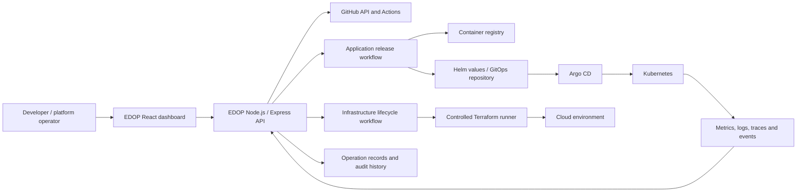

# EDOP architecture

EDOP is an Internal Developer Platform that coordinates existing tools for observing services, releasing applications and managing infrastructure. The current repository is in Phase 0: this document and the frontend are design artifacts; integrations are not implemented.

## System context



## Design boundaries

- GitHub Actions runs CI; EDOP records and presents workflow activity.
- Argo CD reconciles application releases into Kubernetes. A normal application release does not recreate or destroy infrastructure.
- Terraform owns infrastructure changes. EDOP accepts a request and tracks a durable operation; a controlled worker or CI runner executes Terraform asynchronously.
- Application deployment and infrastructure lifecycle are separate workflows, APIs, authorization checks and operation records.
- The frontend never executes shell commands. Infrastructure support begins with one reviewed environment template, not arbitrary Terraform projects.
- Terraform state uses a consistent backend and locking before concurrent operations are enabled.
- External credentials remain in server-side secret storage; they are never returned to the browser.
- Current screens contain explicitly labeled fixtures only. No status shown in the preview is evidence of a live system.

## Proposed repository layout

```text
frontend/src/
  app/                       Central React Router and preview auth guard
  routes/                    Thin route wrappers grouped by feature
  features/<feature>/pages/   Feature page components
  components/                Shared layout, dashboard and UI components
  data/                      Sample fixtures and nav definitions
app/api/src/                 Express routes, services and integrations (later phase)
app/api/src/workflows/       application-deployment/ and infrastructure-lifecycle/
deploy/                      Kubernetes and Helm configuration
gitops/applications/         Argo CD application definitions
terraform/modules/           reviewed reusable Terraform modules
terraform/environments/      known environment templates
observability/               metrics, dashboards and telemetry configuration
docs/                        architecture, API, decisions and runbooks
```

The existing Terraform VPC and security-group modules will be reviewed in Phase 4. This proposed layout does not replace their current repository.

## Frontend route ownership

`frontend/src/app/router.jsx` is the single route table. Route wrappers in `frontend/src/routes/` select feature pages under `frontend/src/features/<feature>/pages/`. `AuthLayout` contains the login route; `ProtectedRoute` guards dashboard routes; and `DashboardLayout` reuses the existing sidebar, header and content shell. The auth context is a development-only, in-memory UI placeholder and does not provide authentication or security. The current data shown by all feature pages remains local sample data.

## Key records

- **Service:** stable ID, display name, repository, default branch, owner and enabled environments.
- **Pipeline run:** provider ID, repository, workflow, branch, commit, status, timestamps, duration and external URL.
- **Deployment:** service, environment, image digest/version, source run, GitOps revision, status and health evidence.
- **Environment:** stable ID, display name, template, region, lifecycle status and approved configuration reference.
- **Infrastructure job:** operation ID, environment, operation kind, requester, status, timestamps, runner ID, plan reference, approval record, result and audit event references.
- **Audit event:** actor, action, target, timestamp, outcome and request/operation correlation IDs.

All state transitions and identifiers are proposals until the backend phase defines and tests their persistence model.
