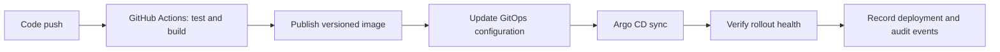

# Workflow designs

Phase 0 designs only. The buttons in the preview are intentionally non-operational.

## Application release

1. A repository change starts the configured CI workflow.
2. CI tests the code, builds an immutable image and publishes it to the registry.
3. The release workflow updates the environment's GitOps reference to that image digest.
4. Argo CD reconciles the change; EDOP records source run, version, environment and resulting health.
5. A failed rollout is surfaced with links to the pipeline and available diagnostic evidence. Recovery is a separate release of a known-good version or a documented GitOps rollback.

Application release operations must not call Terraform or alter infrastructure state.

## Infrastructure lifecycle

```mermaid
flowchart LR
  Request[Authorized request] --> Validate[Validate template and inputs]
  Validate --> Queue[Persist operation and enqueue]
  Queue --> Plan[Controlled runner: terraform plan]
  Plan --> Review[Review plan]
  Review --> Approval[Record approval]
  Approval --> Apply[Controlled runner: terraform apply]
  Apply --> Verify[Verify outputs and resource state]
  Verify --> Audit[Persist result and audit events]
```

- The operator selects a known environment template and submits validated inputs.
- The API checks authentication, role, policy and idempotency, persists an operation record, then queues work. HTTP requests do not wait for Terraform to finish.
- A worker serializes operations for the environment and invokes a controlled runner with server-side credentials and locked remote state.
- The plan is retained and presented for review. Apply requires a recorded approval bound to that plan and operation.
- Completion records runner identifiers, timestamps, exit status, outputs and verification results. Secrets are redacted from logs and responses.
- Destroy is a distinct privileged operation requiring explicit environment selection, fresh plan review and explicit confirmation/approval. It records cleanup verification and residual-resource checks.
- Retries use operation state and idempotency keys; uncertain runner results are reconciled before another apply or destroy is allowed.

## Shared observability

Kubernetes workload state, events, Prometheus metrics, application logs and OpenTelemetry traces will be linked to service, environment, deployment and operation IDs. Collection and retention policies are defined in later phases; the Phase 0 UI displays only illustrative values.
